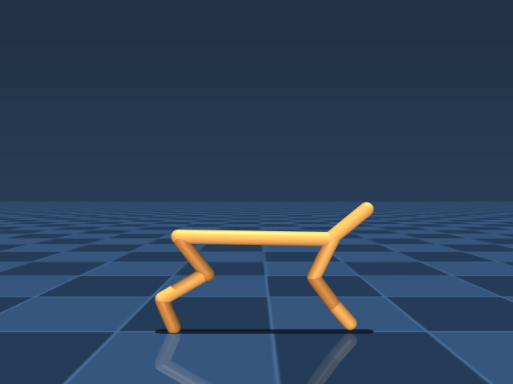

# Habitats: A Framework for Open-Ended Evolution of Agent Objectives

[Habitats](https://github.com/google-deepmind/habitats) is a framework for
open-ended evolution of executable agent objectives (reward functions). Rather
than hand-crafting rewards or optimizing a single predefined task, Habitats
evolves a population of reward–policy pairs where behavioral evaluation guides
objective discovery.

## Overview

Habitats separates **what** to explore from **how** to implement it, and grounds
novelty in learned behavior rather than reward code alone:

*   **Two-Stage Offspring Synthesis (`OffspringPlanner` & `Mutator`)**: A
    population-level LLM *Planner* inspects surviving individuals, cross-fitness
    profiles, and population health metrics to select parents and propose
    natural-language mutation directives. A separate LLM *Mutator* translates
    those directives into executable, validated Python reward functions.
*   **Behavior-Grounded Cross-Fitness & Niche Selection**: Every policy in the
    population is evaluated under every population reward, producing a
    cross-fitness matrix that captures self-mastery, transferability,
    *Specialist Quality (SQ)*, and *Behavioral Diversity (BD)*. Individuals
    survive only if their policy dominates its own reward niche and outperforms
    a random-policy baseline.
*   **Discrete & Continuous-Control Environments**: Supports discrete domains
    (such as the Card Sandbox with tabular Q-learning) and MuJoCo/MJX
    continuous-control environments (Cart-Pole, Hopper, Cheetah, Quadruped, and
    Humanoid with PPO).
*   **Pluggable LLM Backends**: Ships with a Gemini API backend (`google-genai`)
    and a registry (`habitats.lib.llm_client`) for integrating custom LLM
    backends.

## Evolved Behaviors

Behaviors discovered by Habitats across a range of MuJoCo environments:

| Smooth Retro Runner (Cheetah) | High-Speed Backward Hopping (Hopper) | Continuous Backflips (Cheetah) |
| :---: | :---: | :---: |
|  |  |  |
| *Evolved backward gallop in Cheetah* | *Sustains fast reverse hopping* | *Executes continuous backward somersaults* |

## Getting Started

### Launching an Evolution Run

Select a registered preset from `habitats.config.evolution`, configure a local
checkpoint path, and run `EvolutionAlgorithm`:

```shell
python -m habitats.launcher.evolve \
  --config=habitats_mini_card_deck \
  --checkpoint_path=/tmp/habitats_ckpts \
  --num_workers=2 \
  --api_key=$GEMINI_API_KEY
```

By default, `EvolutionAlgorithm` runs with a local in-process `TrainingWorker`.
You can also pass a multi-worker `habitats.training.training_pool.TrainingPool`
for parallel training and cross-fitness evaluation, or customize
`EvolutionAlgorithmConfig` fields such as `num_generations`,
`initial_population_size`, `llm_model`, and `offspring_generator`
(`PLANNED_MUTATION`, `DIRECT_MUTATION`, or `INDEPENDENT`).

### Available Presets

| Preset | Environment | Policy / Trainer |
| :--- | :--- | :--- |
| `habitats_test` | Cart-Pole (smoke test) | MLP / PPO |
| `habitats_mini_card_deck` | Card Sandbox | Tabular / Q-learning |
| `habitats_cartpole` | Cart-Pole (`cartpole/balance`) | MLP / PPO |
| `habitats_hopper` | Hopper (`hopper/hop`) | MLP / PPO |
| `habitats_cheetah` | Cheetah (`cheetah/run`) | MLP / PPO |
| `habitats_quadruped` | Quadruped (`quadruped/run`) | MLP / PPO |
| `habitats_humanoid` | Humanoid (`humanoid/run`) | MLP / PPO |

## About

Habitats is developed and maintained by
[Google DeepMind](https://deepmind.google/).

## License

This project is licensed under the Apache License 2.0. See [LICENSE](LICENSE)
for details.

Disclaimer: This is not an official Google product.

## Citing this work
If you use this library in your work, please cite:

```
@inproceedings{
    bolouri2026habitats,
    title={Habitats: A Framework for Open-Ended Evolution of Agent Objectives},
    author={Nicolas Bolouri and Gaya Mehenni and Daniel Kenji Toyama},
    booktitle={First Workshop on Meta Agents: Managing Agents that Manage Agents},
    year={2026},
    url={https://openreview.net/forum?id=NbzAfPbkxU}
}
```

